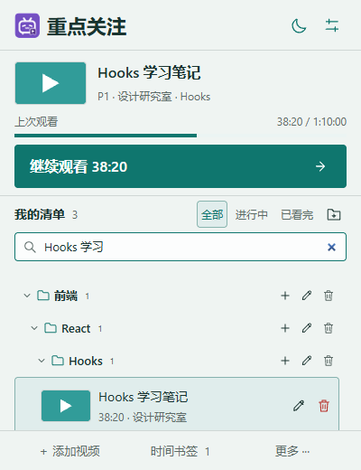
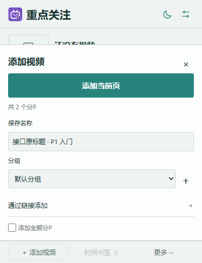

# 重点关注 · B站续播清单 v1.3


Chrome Manifest V3扩展。按分P保存最近采集到的实际观看位置与多个时间书签，独立于B站收藏夹。无需登录、无需后端，清单数据只在本机保存。

**[下载最新版](https://github.com/Harry0622/bili-focus/releases/latest) · [完整使用教程](docs/USAGE.md) · [反馈问题](https://github.com/Harry0622/bili-focus/issues) · [隐私说明](PRIVACY.md)**

## 先下载哪个文件？

| 你想做什么 | 下载内容 |
|---|---|
| 直接安装使用，不编译 | Release里的 **bili-focus-1.3.0.zip** |
| 查看或修改代码 | Clone本仓库，或下载 **bili-focus-1.3.0-source.zip** |

下载页的Assets在版本说明下方。本项目目前通过“加载已解压的扩展程序”安装，尚未发布到Chrome应用商店。

## 界面预览

| 清单与续播 | 多层分组与搜索 | 添加当前页 |
|---|---|---|
|  |  |  |

截图中的进度、分组和部分标题为演示数据。普通视频封面来自公开投稿。

## 安装与更新

1. 从[发布页](https://github.com/Harry0622/bili-focus/releases/latest)下载 `bili-focus-1.3.0.zip`，解压到长期保留的文件夹。
2. Chrome打开 `chrome://extensions`，开启「开发者模式」。
3. 点击「加载已解压的扩展程序」，选择含 `manifest.json` 的文件夹。
4. 固定扩展到工具栏，点击图标使用。

更新已有安装时，将新文件覆盖到原来加载的文件夹，在扩展管理页点击「重新加载」，再刷新B站视频页。保留原加载路径以继续使用原有本机数据，更新前可以导出JSON备份。

`bili-focus-1.3.0-source.zip` 是完整源码包，包含官方组件原始源码、应用适配、锁定依赖、生成资源、测试和图标原图。安装包不需要Node.js；修改代码后才需要重新构建。逐步操作与常见问题见[使用教程](docs/USAGE.md)。

## 界面与使用

固定400×520px，主按钮48px。主视图以快速续播为核心：标题与对齐的主题/设置图标 → 当前目标与唯一「继续观看」主按钮 → 搜索与分组清单 → 添加、书签、更多入口。点击清单行只更换目标，再点击主按钮播放。清单连续独立滚动，只绘制可见行，主操作与底部入口固定。添加、书签和设置是互斥的可收起面板，不新建options页，展开后也不会超出520px。

- **添加**：顶部醒目「添加当前页」，下方折叠「通过链接添加」，支持普通UGC链接、BV号、av号或b23.tv短链。读取后预填标题/分P名称，可修改保存名称、选择分组；留空用默认名。「添加全部分P」将该投稿 `pages[]` 全部分P统一放入目标组；自定义批量名带P序号。视频页按钮保留。
- **分组**：支持多层嵌套，例如课程 → 前端 → React → Hooks。可展开/收起、新建子组、编辑名称/上级或删除，记忆折叠状态。默认分组固定保留。删组及其子组会把视频与待补全链接移回默认组，保留进度与书签，8秒内可撤销。
- **搜索**：按保存名称、原标题、分P名或UP主查找。显示匹配组的祖先路径，临时展开结果，不改已保存的折叠状态。
- **名称和归属**：行内铅笔按钮可重命名、移动分组；保存名称用于插件显示，不修改原标题或下载文件名。元数据刷新保留自定义名；清空恢复默认名。重复添加保留已有名称、分组、进度与书签。
- **采集**：仅对已关注的 `bvid:cid` 采样，默认播放中每5秒一次；暂停、拖动结束、隐藏、结束和关页时补报。各P互不覆盖。
- **续播**：生成 `?p=N&t=秒`。看完后优先进入下一P；最后一P和单P从头播放，仍可「重看上次位置」。
- **书签**：选中视频，展开书签，在对应分P播放页记录当前时间。支持可选备注、修改、跳转、删除；新增书签不改续播位置。
- **删除**：每条清单行右侧有可见删除按钮，8秒内可撤销；书签面板入口仍可使用。
- **主题**：浅色、深色或随系统；选择保存在本机，视频页入口跟随同一设置。
- **颜色**：默认青绿，提供海蓝、陶橙、莓红、橄榄预设；可用原生颜色选择器或输入HEX自定义弹窗配色，自动调整正文和按钮文字对比度。
- **备份**：JSON包含分组树、名称及折叠状态。合并清单与书签，进度取较新采集时间；重复视频保留本机名称/分组与当前设置；空清单导入恢复折叠状态。旧备份可导入，旧视频归入默认组；无效备份不部分写入。

B站播放以站点为准。扩展从不写播放器 `currentTime` 或调用seek。站点恢复到别的位置后，扩展采集实际位置回写，不宣称位置绝对准确。

## 封面与字号

当前视频与列表行均显示封面，固定尺寸、懒加载，并使用no-referrer。接口返回的HTTP封面地址会转换成同一CDN域名的HTTPS地址；对支持的BFS图片请求160px缩略图，失败回退原图。旧记录缺少封面时通过后台元数据刷新补全，也可在书签面板「刷新视频信息」。不把封面二进制写入本机数据。

主标题22px、视频标题16px、列表标题14px、主按钮16px，设置正文13px。去掉重复的本机/免登录说明、页脚提示和装饰性文案；进度含义改为时间处的悬停说明。

## Rare UI实际接入

实际使用 [Rare UI](https://rareui.com) 官方 **Theme Selector** 和 **ToastCard**。主题有微型界面预览，保存/删除/撤销反馈使用官方图标入场与描边动画；减少动态效果偏好生效。

- 仓库：[swamimalode07/rare-ui](https://github.com/swamimalode07/rare-ui)
- 锁定提交：`21554cba3ac751c1f9c06869eadb9d44a0af7225`
- 原始文件：`vendor/rare-ui/theme-selector.tsx`、`vendor/rare-ui/toast.tsx`，均保持上游内容不变。
- 来源和SHA-256：`vendor/rare-ui/provenance.json`，构建与检查会核对。
- 实际调用：`ui/rare-theme.tsx` 直接import官方 `ThemeSelector`；`ui/rare-toast.tsx` 直接import官方 `ToastCard`，使用单个反馈位置与原生即时后备提示，避免排队反馈造成撤销按钮重复。
- 样式适配：`ui/rare-theme.css`；官方预览、受控单选及方向键逻辑仍实际运行。
- 许可证、版权及署名条件：`vendor/rare-ui/LICENSE`。设置内也有可见来源链接。

组件均编译成本机文件，两个入口共享React。只在首次设置或操作反馈时加载；反馈先用原生提示立即显示，首次删除的撤销按钮会保持原位置直到提示结束。初始清单不加载组件，不访问CDN。后续操作复用已挂载组件。本版与v1.2的实测和资源开销见 `docs/PERFORMANCE.md`；v1.1历史报告另存 `docs/PERFORMANCE-v1.1.md`。

已应用用户确认的紫色B站电视/书签图标，导出16/32/48/128px；原图在源码包 `design/approved-purple-icon.png`，界面和工具栏均已使用，没有重新生成。

## 本机清理

设置 →「本机空间与清理」显示占用估算、待清理数量、预计释放空间。默认期限30天，可选7/30/60/90/180/365天；清理过期的已看完视频、失效记录和待补全链接。

- 默认保留带书签的视频、正常进行中的视频及近期添加或观看的记录。
- **只允许手动清理**，已经移除自动清理入口和后台删除用户记录的逻辑；旧版本的自动清理开关也会被禁用。
- 手动清理8秒内可整批撤销；到期后后台回收该次已授权删除的撤销缓存。恢复期内仍占空间，浏览器休眠或关闭会推迟回收。
- 按实际占用检查：大于1GB（1,073,741,824字节）时，弹窗显示手动清理入口，工具栏显示「!」；提醒本身不删除记录。

不保存封面二进制、视频、采样流水或运行日志。占用优先使用浏览器getBytesInUse实际计量；首屏之后异步读取，不阻塞清单。仍使用Chrome默认约10MB配额，不申请无限存储，因此正常安装无法达到1GB；1GB规则不代表提供1GB数据容量。

## 范围与权限

仅支持普通 `/video/BV...`、`/video/av...` 投稿。番剧、直播、回放与非标准链接明确提示不支持。

权限只有 `storage / tabs / alarms`；站点限HTTPS的 bilibili.com、hdslb.com、b23.tv（短链需要）。没有cookies、全站、通知、侧栏或同步权限，不检测登录态。

数据保存于 `chrome.storage.local` 的 `focusState` 单键。添加、刷新使用公共view接口，`credentials: omit`；封面no-referrer。没有数据上传、遥测或分析SDK，性能标记仅存于当前页面内存。

接口失败保留缓存，缺少cid的链接进入待补全队列；按1、2、4…分钟退避，最多一天。`-404` 标记失效且保留记录，只有符合用户清理规则的过期项才清理。

## 构建与测试

Node.js 22+；Windows打包使用PowerShell。

```text
npm ci
npm run build
npm test
npm run check
npm run package
```

官方源码修改会触发SHA校验失败；应用适配放在 `ui/`。依赖由 `package-lock.json` 锁定。安装后的扩展不会运行npm或联网加载框架。

浏览器验证使用独立、可重置的测试目录：

```text
npx --yes --package playwright playwright install chromium
powershell -NoProfile -File tools/open-test-browser.ps1
npx --yes --package @playwright/cli playwright-cli -s=bili-focus-check --raw run-code --filename tools/library-check.js
npx --yes --package @playwright/cli playwright-cli -s=bili-focus-check --raw run-code --filename tools/addition-check.js
npx --yes --package @playwright/cli playwright-cli -s=bili-focus-check --raw run-code --filename tools/content-check.js
npx --yes --package @playwright/cli playwright-cli -s=bili-focus-check --raw run-code --filename tools/customization-check.js
npx --yes --package @playwright/cli playwright-cli -s=bili-focus-check close
```

本版性能对比：先关闭测试浏览器，运行 `tools/open-test-browser.ps1 -WithBaseline`，再通过同一CLI运行 `tools/library-benchmark.js`，会同时加载保留的v1.2安装包。原始结果在 `docs/performance-v1.3.json`。历史程序 `tools/popup-benchmark.js` 与 `tools/popup-check.js` 对应旧版，请使用旧源码包复现；历史报告在 `docs/PERFORMANCE-v1.1.md`。

程序会重置独立测试目录里的扩展数据，不使用日常浏览器。`tests/baseline/` 保留基线安装包。验证边界见 `TEST_REPORT.md`。各脚本建议在新测试页面运行，避免上一脚本的测试注入影响后续场景。

## 开源与贡献

项目自身代码采用[MIT许可证](LICENSE)，欢迎学习、修改、提交[Issue](https://github.com/Harry0622/bili-focus/issues)或Pull Request，详见[贡献说明](CONTRIBUTING.md)。Rare UI等第三方部分保留各自授权，具体范围见[第三方声明](THIRD_PARTY_NOTICES.md)，不能将项目的MIT许可证视为对上游限制的替代。

查看[更新记录](CHANGELOG.md)、[开发说明](docs/DEVELOPMENT.md)、[测试报告](TEST_REPORT.md)和[性能实测](docs/PERFORMANCE.md)。这是独立项目，非哔哩哔哩官方扩展。
