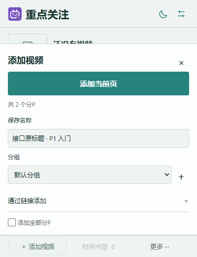
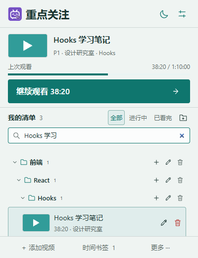
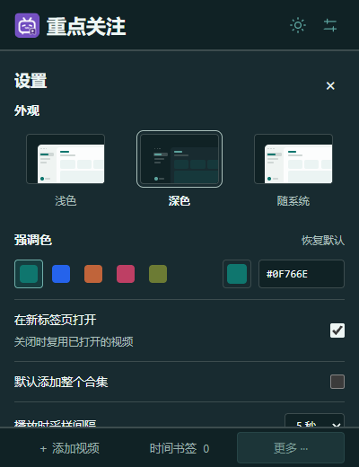

# 使用教程

## 安装

1. 打开[最新发布页](https://github.com/Harry0622/bili-focus/releases/latest)。
2. 下载Assets中的 **bili-focus-1.3.0.zip**，解压到准备长期保留的目录，例如“文档/BiliFocus”。不要直接在压缩包里加载。
3. Chrome地址栏输入 `chrome://extensions/`，打开右上角“开发者模式”。
4. 点“加载已解压的扩展程序”，选择能直接看到 `manifest.json` 的文件夹。
5. 在浏览器工具栏的扩展菜单中固定“重点关注”，打开普通B站视频页，刷新一次后即可使用。

这不是Chrome应用商店安装。Release的安装ZIP包含已构建资源，使用者无需安装Node.js。GitHub自动提供的Source code压缩包和带-source的附件主要供开发使用；普通使用者请选择上面的安装ZIP。

## 添加视频

### 添加当前页面

1. 打开普通B站视频投稿，点击工具栏“重点关注”。
2. 点底部“添加视频”，面板最上方是醒目的“添加当前页”。
3. 稍等标题读取完成。“保存名称”会带入原标题；多P时还包含当前P序号和分P名称。
4. 可修改名称并选择目标分组。未选择其他组时保存到“默认分组”。
5. 需要整个投稿的全部分P时勾选“添加全部分P”，它们会统一保存到所选组。自定义批量名称会补上各自P序号。
6. 点“添加当前页”保存。

### 粘贴链接添加

在添加面板下方展开“通过链接添加”，粘贴普通视频链接、BV号、av号或b23.tv短链，点“读取”。确认名称和分组后点“保存链接视频”。

番剧、直播等类型暂不支持；不能读取信息的普通链接可暂存，之后重试补全。重复添加不会覆盖已有名称、分组、观看位置或书签。

## 选择与继续观看

点击清单中的视频，只会切换当前目标，不会自动跳转。点上方“继续观看”才打开对应分P。

- 未看完：携带最近采集的播放时间打开。
- 已看完且还有下一P：进入下一P。
- 最后一P或单P看完：从头播放，也可选择“重看上次位置”。

B站可能使用自己的记忆播放位置。扩展不强制拖动播放器，会继续记录页面上的实际播放位置。首次安装、重新加载或更新扩展后，请刷新已打开的视频页。

## 多层分组和搜索

“我的清单”右侧文件夹加号可建立顶层组。分组行的加号可新建子分组，例如“课程 → 前端 → React → Hooks”。点击组名或箭头展开/收起，再打开插件时保留折叠状态。

分组行的铅笔可修改名称或上级；不允许将组移动到自己或自己的子组里。默认分组固定保留。

搜索框支持保存名称、原始视频标题、分P名和UP主。搜索会临时展开匹配记录的祖先分组；清空搜索后恢复原折叠状态。视频多时直接在清单内部向下滚动，顶部主操作和底部入口保持固定。

## 重命名、移动和删除

每条视频右侧都有铅笔与删除按钮。

- **改名称/分组**：点铅笔，修改后保存。名称仅改变插件中的显示，不修改原视频标题或下载文件名；刷新视频信息不会覆盖自定义名。清空名称可恢复默认标题规则。
- **删视频**：点删除，8秒内可用提示中的“撤销”恢复，进度和书签一起恢复。
- **删分组**：确认后删除该组及其子组，视频和待补全链接移回默认组，进度和书签保留；8秒内可撤销。默认组不能删除。

## 时间书签

选中视频后展开“时间书签”。在该分P的播放页面打开着时，点“记录当前播放时间”，可附加备注；它不会改变续播位置。之后可跳到对应时间、改备注或删除书签。

## 主题与颜色

右上角月亮/太阳可快速切换浅色和深色。设置中可选浅色、深色或随系统；强调色支持预设、原生选色器和HEX输入，保存在本机。主题预览和操作反馈实际使用Rare UI，按需加载。

## 手动清理与备份

设置 →“空间与清理”查看占用、筛选期限、预估可清理条目，再点“手动清理”。只处理符合期限的已看完、失效或待补全记录；默认保留带书签及正常进行中的视频。清理后8秒内可撤销。

**没有自动清理。** 超过1GB时只提醒并提供手动清理入口，不会自行删除。当前仍使用Chrome默认约10MB本地配额，因此1GB提醒规则不代表支持存储1GB数据。

设置 →“本机备份”可导出JSON，建议更新或整理前保存一份。导入会合并分组、视频和书签，进度取较新记录，已有视频保留本机名称和归属，保留当前设置。旧备份可以导入；旧视频进入默认分组。

卸载扩展会删除浏览器保存的扩展数据；需要保留清单时请先导出JSON。

## 更新

先导出备份，关闭弹窗，将新安装ZIP解压并覆盖**原来加载的目录**；到 `chrome://extensions/` 点扩展的“重新加载”，再刷新B站视频页。不必先卸载扩展。

## 常见问题

| 情况 | 处理 |
|---|---|
| 选择文件夹后提示缺少manifest | 选择直接包含manifest.json的那一层，不是它的父目录或ZIP |
| 视频页没有入口/不记录进度 | 确认是普通投稿、已经加入清单；更新扩展后刷新视频页 |
| 标题或封面暂时没有 | 在书签面板点“刷新视频信息”；网络或接口失败时原记录仍保留 |
| 续播时间与B站打开的位置不同 | B站有自己的恢复逻辑，扩展以之后采集到的实际播放时间为准 |
| 无法添加番剧或直播 | 当前只支持普通UGC视频投稿 |
| 清单很多 | 搜索、分组、滚动，必要时先备份再手动清理 |
| 换电脑找不到清单 | 本机保存、没有云同步；在原电脑导出JSON，到新电脑导入 |

仍有问题可到[Issues](https://github.com/Harry0622/bili-focus/issues)提交。请提供扩展版本、Chrome版本、复现步骤；截图或备份请先移除个人信息。
